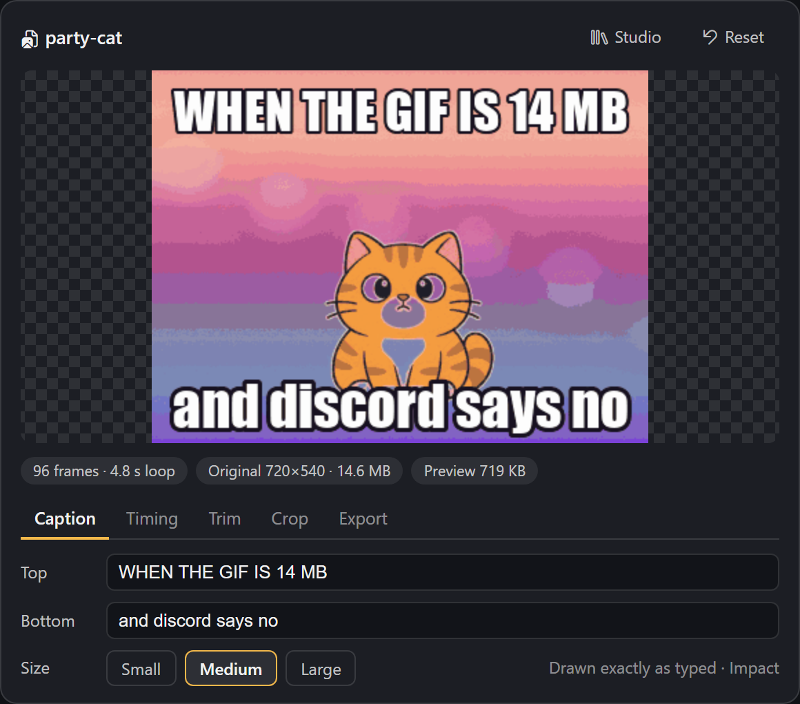
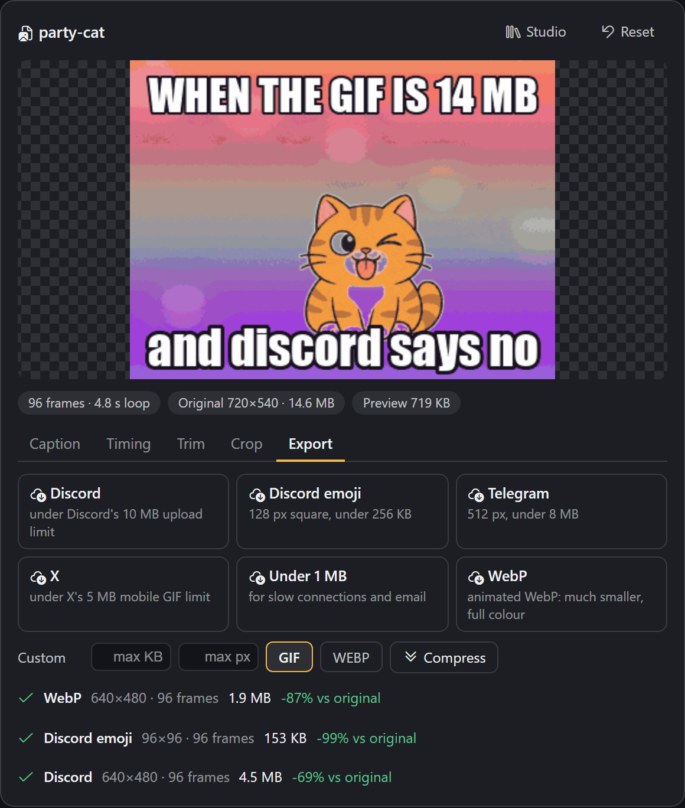
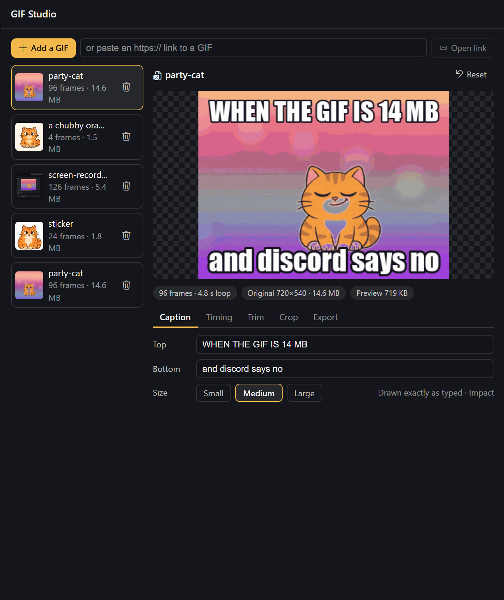

# GIF Tool

Show, edit and compress GIFs inside Hermes Agent.

GIFs are the one format every chat app plays and nobody can easily edit, and they are huge. GIF Tool
gives Hermes a real GIF workflow:

- **Show any GIF in chat.** Give Hermes a file path or a link ("open this gif …") and it plays in a
  card in Hermes Desktop. On Telegram, Discord and the CLI you get the file as usual.
- **Edit it in the card.** Exact captions, speed, reverse, boomerang, trim, per-frame timing, drop
  frames, crop. The preview updates as you type. The original is never changed, so Reset undoes
  everything.
- **Compress it for where it is going.** One click for Discord (10 MB), Discord emoji (256 KB),
  Telegram, X (5 MB), "under 1 MB", animated WebP, or your own size limit. The compressor keeps
  shrinking until the file fits and tells you the size before and after.
- **Create one from a prompt.** `gif_create` makes a four-frame meme GIF with the image model behind
  your ChatGPT/Codex sign-in, with captions drawn exactly as you typed them.
- **GIF Studio.** Command palette → "GIF Tool: open studio": every GIF in your profile, drop in a
  file or paste a link, no agent turn needed.

Everything except `gif_create` and downloading a link runs on your machine, costs nothing, and takes
a second or two.





Screenshots show the card in a test page with a neutral dark theme; in Hermes Desktop it follows your
theme.

## Tools

| Tool | What it does | Cost |
|---|---|---|
| `gif_open` | A GIF / animated WebP / APNG / PNG / JPEG from a path or https link → an editable project, shown in chat | free (downloads the link you give it) |
| `gif_edit` | Captions, text size, speed, trim, reverse, boomerang, crop, keep every Nth frame, per-frame delays | free, local |
| `gif_export` | Compress to a preset or to `max_kb` / `max_px`, as GIF or WebP; works on a project or straight on a path/link | free, local |
| `gif_create` | Prompt (+ optional per-frame beats and captions) → a looping 4-frame GIF | one image from your ChatGPT plan, 30–60 s |

Example requests:

- "Open `~/Downloads/demo.gif`, trim it to the first 40 frames and make it 1.5× faster."
- "This GIF is 14 MB and Discord won't take it. Fix it." → `gif_export` with the `discord` preset.
- "Turn it into a Discord emoji." → 128 px square under 256 KB.
- "Make a GIF of a smug cartoon cat winking. Top text: WHEN THE BUILD PASSES."

## How the compression works

Pure Pillow, no external binaries:

1. **One shared palette** for all frames and no dithering (dither noise defeats GIF's LZW coding).
2. **Frame differencing.** Pixels that did not change since the previous frame are written as
   transparent, so a static background costs almost nothing. An optional tolerance treats
   nearly-identical pixels as unchanged; it is measured against what is actually on screen, so the
   error never builds up over the animation.
3. **Fit to a size.** If the result is over the limit, the compressor walks a ladder (tolerance →
   smaller frame → fewer colours → fewer frames), sized from how far over it was. Long GIFs are
   sized on a 12-frame sample first, so the full encode usually runs once.
4. Animations with real transparency keep whole frames, so stickers never smear.

Measured on a 14.6 MB, 96-frame, 720×540 test GIF: 5.3 MB for Discord (−64%), 4.1 MB for X,
2.5 MB for Telegram, 785 KB for "under 1 MB" and 1.2 MB as WebP (−92%), each in 2–6 seconds. A
1.8 MB transparent sticker becomes a 114 KB Discord emoji. Results vary with the content: flat
cartoons shrink far more than camera footage.

## Requirements

- Hermes Agent **0.22.0** or newer. The card needs a Hermes Desktop with tool-media renderers; older
  Desktops and other surfaces show the plain GIF.
- Pillow (`>=10.1,<14`) and httpx, both of which Hermes already ships.
- Only for `gif_create`: signed in to **OpenAI Codex** in Hermes (Desktop → Providers, or
  `hermes auth add openai-codex`). Everything else works without it.

## Install

```bash
hermes plugins install gif-tool
```

Before the catalog listing is live, install from the repository URL instead:
`hermes plugins install <this repo's https URL>`.

Restart Hermes once after installing so the card's backend routes mount.

## Disclosures

- **Network, `gif_open` / `gif_export` with a link, and Studio "Open link":** one HTTPS download of
  the link you gave. https only, default port, no cookies or credentials; hosts that resolve to
  private, local or link-local addresses are refused, and every redirect is checked again. A GIPHY or
  Tenor page link is followed once to its `og:image`. Nothing is uploaded.
- **Network, `gif_create`:** one HTTPS `POST` to
  `https://chatgpt.com/backend-api/codex/images/generations` per call. Hermes sends it with your
  Codex sign-in through `credentialed_provider_request`; the plugin never sees, stores or refreshes
  the token. Only the text prompt is sent. Captions are **not** sent; they are drawn locally.
- **Cost:** each `gif_create` uses one image from your ChatGPT plan's image allowance. No other
  feature costs anything. When the plan's limit is used up the tool says so and stops.
- **Model:** the Codex endpoint ignores the requested model and does not report which model made the
  image, so GIF Tool cannot pick or confirm a specific version. It also ignores the requested size;
  GIF Tool crops locally. Measurements are in [docs/codex-image-findings.md](docs/codex-image-findings.md).
- **Reads outside its own data:** the image file whose path you give `gif_open` / `gif_export`, and
  a system font for captions (Impact on Windows/macOS, DejaVu Sans Bold on Linux, else Pillow's
  built-in font).
- **Data stored:** each project (a copy of the source image plus a `project.json` with your edits)
  under `$HERMES_HOME/plugin-data/gif-tool/projects/<id>/`. Rendered files go to
  `$HERMES_HOME/cache/generated/images/`, where Hermes delivers `MEDIA:` files from. Studio's delete
  button removes a project folder.
- **No** shell commands, background processes, telemetry, self-updates, or stored credentials.

## Limits

- Sources up to 40 MB and 8192 px. Animations longer than 240 frames are opened at every Nth frame
  (timing is kept). Working resolution is capped at 800 px on the long side.
- Studio uploads are capped at 25 MB; larger files open through `gif_open` with a path.
- `gif_create` makes 4 frames (one 2×2 sprite sheet). Expression changes and small motions loop
  best. The Codex service refuses direct GIF output, which is why frames are built locally.
- GIF has 256 colours and no dithering is applied, so smooth gradients can band. The WebP export
  keeps full colour.

## Development

```bash
python -m pytest tests     # offline: encoder round-trips, compressor, edits, validation
hermes plugins doctor .
hermes plugins validate . --install-deps
```

`desktop/plugin.js` is plain ESM with no build step.

## License

MIT
